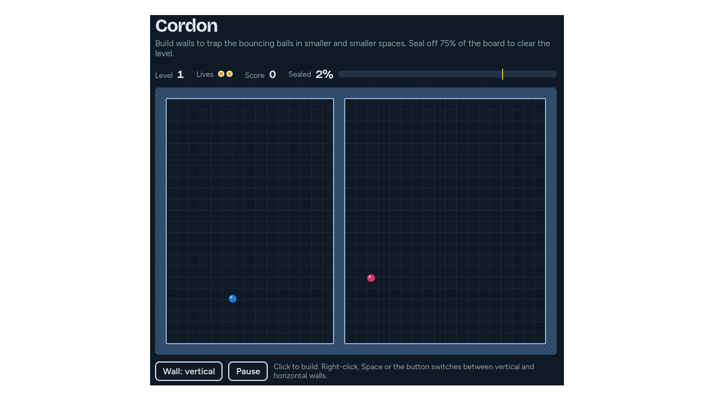

# jezzball



Jezzball-like game

## Docker

Build the image and serve the game on port 8080:

```bash
docker build -t jezzball .
docker run --rm -p 8080:80 jezzball
```

Open http://localhost:8080. The typefaces load from Google Fonts, so the browser needs an internet connection.
